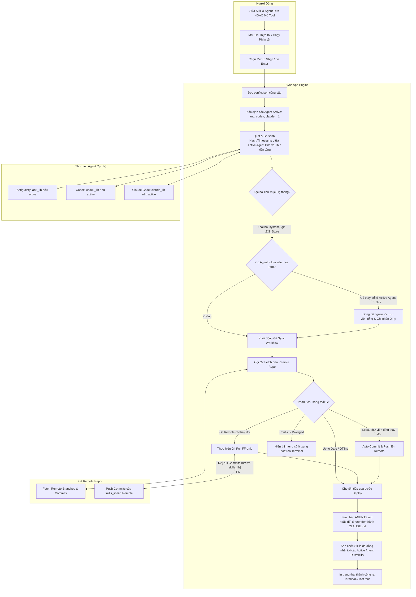

# Business Process Specification: Skills Auto Sync Tool (`_spec1_business_process`)

> **Version:** 2.2.0  
> **Last Updated:** 2026-08-06  
> **Target Audience:** BA, Dev Agent, System Architect, Operations  

---

## 1. Biểu đồ Quy trình Nghiệp vụ Swimlane (Macro Workflow)

Biểu đồ mô tả sự tương tác vĩ mô ở chế độ dòng lệnh (CLI): **Người dùng**, **Sync Engine (CLI App)**, **Kho chứa Git Remote** và **Thư mục Agent Cục bộ** (bao gồm `Antigravity`, `Codex`, và `Claude Code`).



---

## 2. Ma trận Quyết định Đồng bộ 3 Nguồn (3-Source Sync & Decision Matrix)

Engine quản lý đồng bộ đồng thời giữa:
1. **Thư mục Agent Cục bộ** (`anti_lib`, `codex_lib`, `claude_lib` - được tự động nhận diện nếu toggle tương ứng đặt bằng `1` trong `config.json`).
2. **Thư viện Tổng** (`skills_lib` - thư mục chứa git repo cục bộ).
3. **Git Remote Repository** (`git_repo` - liên kết repository cấu hình).

Bảng dưới đây quy định tất cả các luật nghiệp vụ tự động hóa:

| ID Luật | Nguồn Thay đổi (Source) | Trạng thái Git / Working Tree | Bộ lọc Loại trừ (Ignore Rules) | Hành động Tự động của Engine | Phản hồi Terminal (CLI Output) |
| :--- | :--- | :--- | :--- | :--- | :--- |
| `RULE_00` | Sửa skill trực tiếp ở các Active Agent Dirs | Nút Sync được kích hoạt (Nhập 1) | Bỏ qua `.system` của Codex, `.git`, `.DS_Store` | 1. Gom file mới/sửa từ các Agent được kích hoạt ➔ `skills_lib`.<br>2. Cập nhật sang các Agent kích hoạt còn lại cục bộ.<br>3. `git commit` & `git push` lên Remote. | "Phát hiện thay đổi ở [Agent]. Đã gom về Thư viện tổng & Push Git!" |
| `RULE_01` | Các nguồn khớp nhau | Git Up-to-date & Clean | Bỏ qua `.system` | Bỏ qua các bước chép đè. Đảm bảo các Active Agent đồng bộ 100%. | "Dữ liệu đã mới nhất trên các Agent và Git." |
| `RULE_02` | Git Remote có commit mới | Remote Ahead | Bỏ qua `.system` | 1. `git pull --ff-only`.<br>2. Deploy lại Adapters & Skills sang các Active Agent Dirs. | "Đã tự động kéo commit mới từ Git và cập nhật các Agent." |
| `RULE_03` | Thư viện tổng `skills_lib` có thay đổi mới | Local Ahead | Bỏ qua `.system` | 1. Tự động `git commit` & `git push`.<br>2. Sync sang các Active Agent Dirs. | "Đã đẩy thay đổi mới lên Git Remote." |
| `RULE_04` | Xung đột Git Remote & Local | Diverged | Bỏ qua `.system` | Dừng tự động. Hiển thị menu hỏi phương án giải quyết (Terminal Input). | "⚠️ Phát hiện xung đột dữ liệu Git Remote. Vui lòng chọn..." |
| `RULE_05` | Xung đột chéo giữa các Agent | Có 2 Agent cùng sửa 1 file | Bỏ qua `.system` | Lấy file có **Modified Timestamp mới nhất** ghi đè, tạo file `.bak_{timestamp}` cho file cũ hơn để backup. | "⚠️ Xung đột file. Đã lấy bản mới nhất từ [Agent] và tạo backup." |

---

## 3. Quy tắc Loại trừ Thư mục Hệ thống (Ignore System Directories)

Khi quét và đồng bộ dữ liệu, **BẮT BUỘC** áp dụng danh sách loại trừ sau:

```text
IGNORE_PATTERNS = [
    "**/skills/.system/**",      # Thư mục hệ thống nội bộ của Codex
    "**/.git/**",                # Thư mục quản lý Git
    "**/.DS_Store",              # File cache Finder của macOS
    "**/desktop.ini",            # File cache Explorer của Windows
    "**/*.tmp",                  # File tạm thời
    "**/*.bak*"                  # Các file backup
]
```

* **Quy tắc cô lập Codex:** Thư mục `.codex/skills/.system` chứa cấu hình nội bộ của Codex. Engine **tuyệt đối không được copy .system vào skills_lib** và **tuyệt đối không xóa/ghi đè .system** khi sync từ thư viện tổng sang Codex.

---

## 4. Điểm Rủi ro & Phương án Dự phòng (Risks & Fallbacks)

1. **Lỗi kết nối Git Remote:**
   * *Tình huống:* Không thể kết nối với GitHub/GitLab (Mất mạng hoặc sai credentials).
   * *Xử lý dự phòng:* Engine tự chuyển sang chế độ **Offline Sync** (Vẫn chạy đồng bộ cục bộ giữa các Active Agent Dirs và `skills_lib` trên máy). Hiện cảnh báo đỏ/vàng trên Terminal: `[Offline Mode] Tiếp tục đồng bộ cục bộ không qua Git.`
2. **Rủi ro Ghi đè file đang chỉnh sửa dở:**
   * *Xử lý dự phòng:* Trước khi sao chép đè bất kỳ file nào từ Library sang Agent hoặc ngược lại, Engine kiểm tra mã hash MD5. Nếu file chuẩn bị bị ghi đè có thay đổi mới chưa commit, tạo file `.bak_{timestamp}` ngay tại thư mục đó để đề phòng mất dữ liệu.
