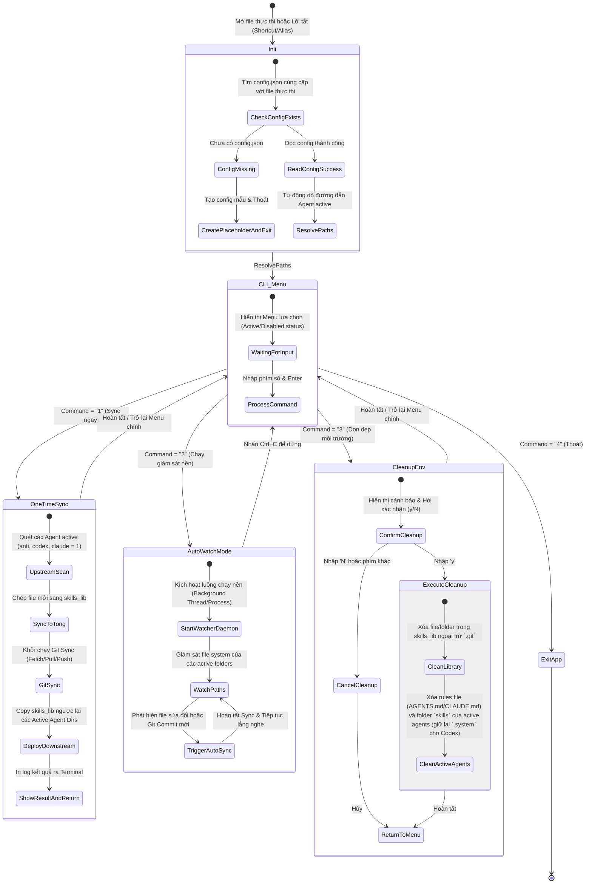
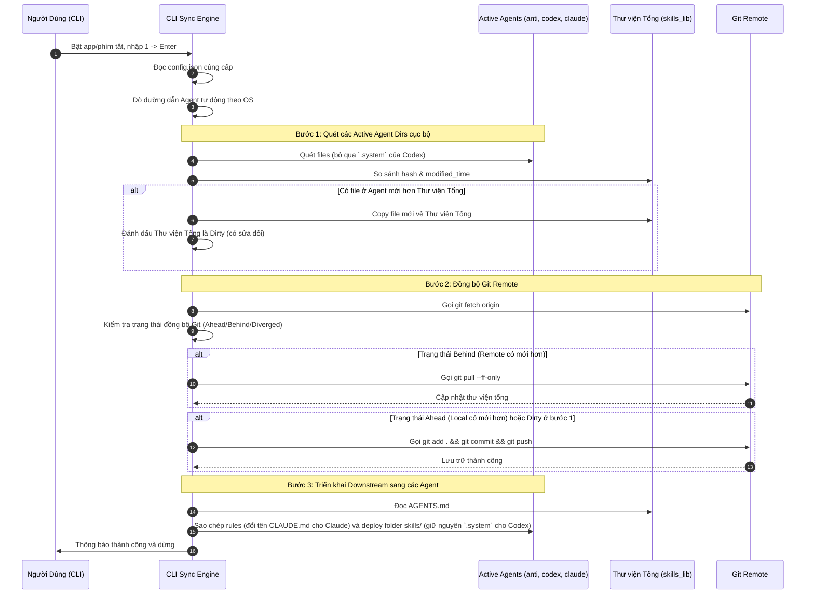
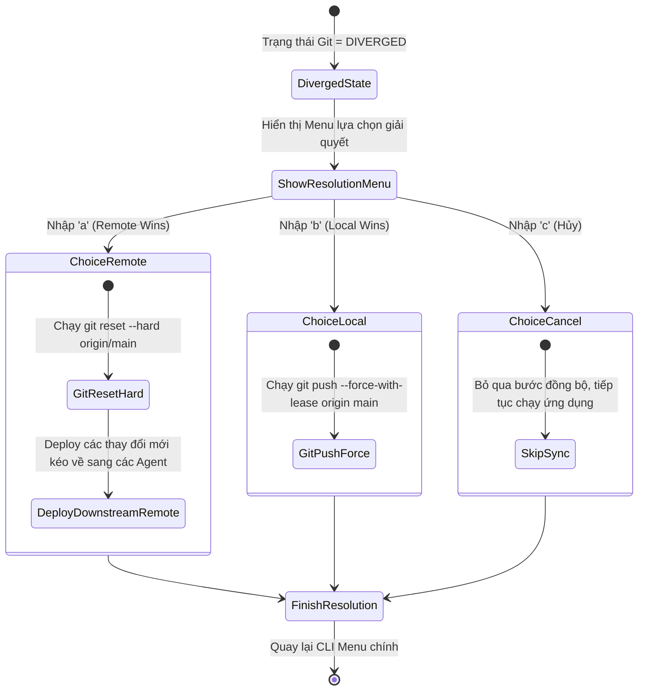

# Feature Flow & State Specification: Skills Auto Sync Tool (`_spec2_feature_flow`)

> **Version:** 2.2.0  
> **Last Updated:** 2026-08-06  
> **Target Audience:** Developers, Dev Agents, QA Engineers  

---

## 1. Sơ đồ Chuyển Trạng thái Engine CLI (CLI State Diagram)

Sơ đồ mô tả vòng đời hoạt động của ứng dụng dòng lệnh (CLI):

---

## 2. Luồng Đồng bộ Ngược và Đẩy Git (CLI Sync Sequence)

---

## 3. Luồng Nghiệp vụ Giải quyết Xung đột Git Diverged (Conflict Resolution Flow)

Khi phát hiện trạng thái Git là `DIVERGED`:

