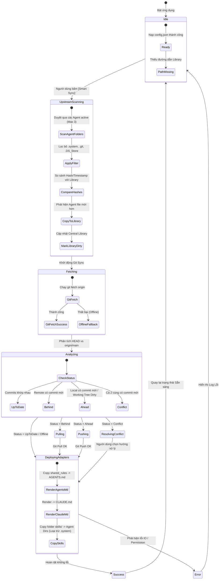
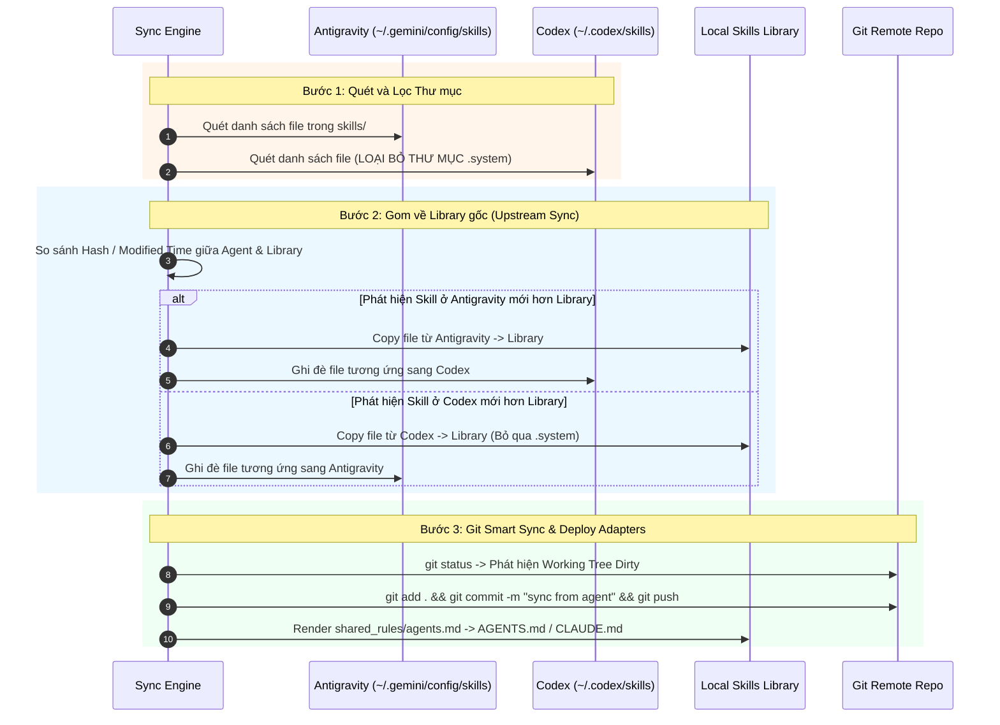
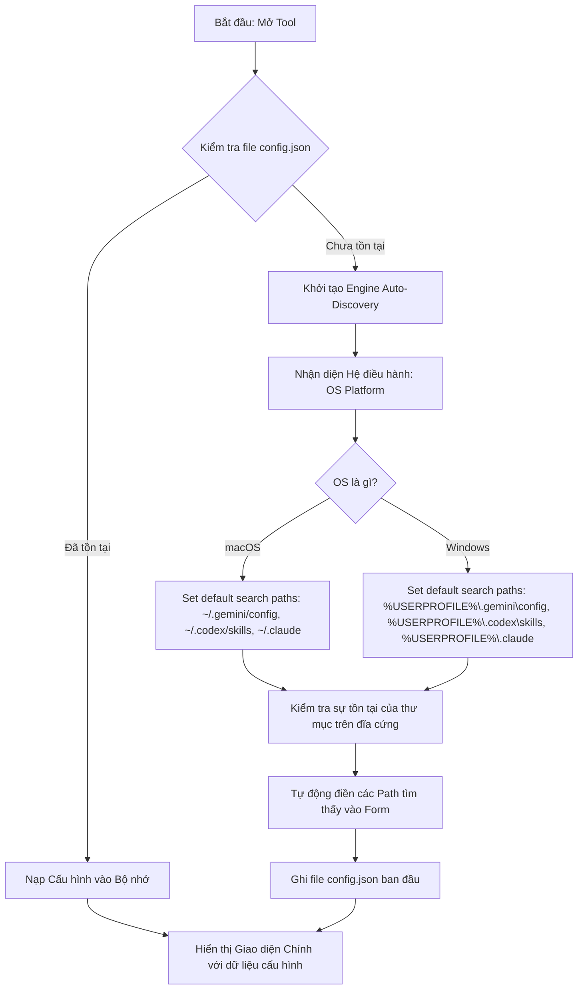

# Feature Flow & State Specification: Skills Auto Sync Tool (`_spec2_feature_flow`)

> **Version:** 1.1.0  
> **Last Updated:** 2026-07-25  
> **Target Audience:** Frontend/Backend Developers, Dev Agents, QA Engineers  

---

## 1. Sơ đồ Chuyển Trạng thái Engine (State Diagram)

Sơ đồ mô tả toàn bộ vòng đời trạng thái của **Smart Sync Engine** khi vận hành (kèm giai đoạn **Upstream Scan & Sync**):

---

## 2. Luồng Đồng bộ Ngược 3 Nguồn (Upstream Reverse Sync Sequence)

Nhiệm vụ: Khi người dùng chỉnh sửa skill trực tiếp ở Antigravity hay Codex, Engine sẽ phát hiện, gom về Library gốc trước khi đẩy lên Git Remote.

---

## 3. Luồng Khởi chạy Lần đầu & Tự động Phát hiện Đường dẫn (First-Time Setup Flow)

---

## 4. Chi tiết Logic Xử lý Xung đột Git (Conflict Resolution Logic)

Khi Git báo trạng thái **Diverged** (Local và Remote đều có commit mới không thể auto fast-forward):

1. **Tạm dừng tiến trình Smart Sync tự động.**
2. **Hiển thị Modal Xử lý Xung đột (Conflict Dialog)** với 3 tùy chọn:
   * **Option A: Pull & Override Local (Chấp nhận bản trên Remote):**
     * Thực thi: `git reset --hard origin/main`
     * Tác động: Bỏ tất cả thay đổi local chưa push, lấy bản remote về.
   * **Option B: Push Force (Dùng bản tại Máy hiện tại):**
     * Thực thi: `git push --force-with-lease origin main`
     * Tác động: Ghi đè bản remote bằng bản local của máy này.
   * **Option C: Manual Merge (Tự giải quyết thủ công):**
     * Thực thi: Mở cửa sổ Terminal / Git Client để người dùng tự gộp code.

