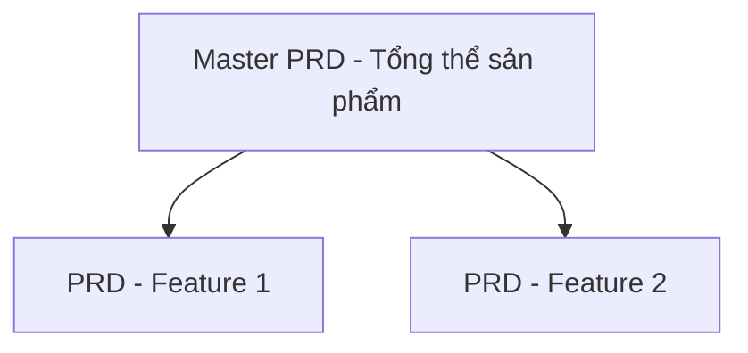

# [TÊN SẢN PHẨM] - MASTER PRODUCT REQUIREMENT DOCUMENT (PRD)

---

## DOCUMENT CONTROL

*   **Google Doc ID:** `xxx`
*   **Tab ID:** `xxx`

### 1. Project Stakeholders (RACI)
*Xác định rõ vai trò và trách nhiệm của các thành viên cốt lõi trong dự án.*

*   **Product Owner / PM:** [Tên người chịu trách nhiệm chính về sản phẩm]
*   **Tech Lead:** [Tên người chịu trách nhiệm về kiến trúc kỹ thuật]
*   **Lead Designer:** [Tên người chịu trách nhiệm về UI/UX]
*   **QA/QC Lead:** [Tên người chịu trách nhiệm kiểm thử chất lượng]
*   **Sponsor / Stakeholders:** [Người duyệt ngân sách / các bên liên quan cần báo cáo]

### 2. Glossary & Terminology (Thuật ngữ)
*Định nghĩa các từ viết tắt, thuật ngữ chuyên ngành hoặc khái niệm đặc thù.*

*   **[Thuật ngữ 1]:** [Định nghĩa chi tiết để người mới đọc vào cũng hiểu được]
*   **[Thuật ngữ 2]:** [Ví dụ: Active User = User có phát sinh tối thiểu 1 phiên học/ngày]

### 3. Key Resources & References (Liên kết tài nguyên)
*Tổng hợp các đường dẫn tương đối hoặc bên ngoài quan trọng.*

*   **UI/UX Design:** [Link Figma / Adobe XD]
*   **Project Board:** [Link Jira / Linear / Trello]
*   **Tech Architecture:** [Link System Architecture / Database Schema Document]
*   **API Docs:** [Link Swagger / Postman Collection]

---

## I. Overview (Executive Summary)

### 1. Document Goal
[Mô tả tóm tắt vai trò và mục tiêu định hướng của tài liệu Master PRD này]

### 2. Product Scope
*   **In Scope:** [Các tính năng, luồng nghiệp vụ SẼ phát triển trong chu kỳ này]
*   **Out of Scope:** [Các tính năng, ý tưởng tạm thời CHƯA làm để tối ưu nguồn lực]

---

## II. Vision, Goals & Success Metrics

### 1. Product Vision
*   **North Star (Dài hạn):** [Tầm nhìn dài hạn của sản phẩm, giải quyết bài toán lớn nào trong 3-5 năm tới]

### 2. Product Goals (Ngắn hạn)
*   **Objective cụ thể:** [Mục tiêu ngắn hạn cần đạt được sau khi launch phiên bản này - ví dụ: Validated MVP, Growth User, hay Monetization...]

### 3. Success Metrics & High-level Analytics
*Định nghĩa các chỉ số đo lường hiệu quả của sản phẩm và hạ tầng analytics chung.*

*   **Hạ tầng đo lường chính:** [Ví dụ: Mixpanel cho hành vi người dùng, GA4 cho phễu Marketing, Sentry cho Crash log]

| Metric Type | Metric Name | Definition | Cách đo / Tool đo | Target |
| :--- | :--- | :--- | :--- | :--- |
| **Primary** | [Chỉ số chính] | [Công thức / Cách tính chỉ số cốt lõi] | [Ví dụ: GA4, Amplitude, SQL] | [Con số mục tiêu] |
| **Secondary** | [Chỉ số phụ] | [Công thức / Cách tính chỉ số phụ] | [Ví dụ: Firebase Analytics] | [Con số mục tiêu] |

---

## III. Problem, Target Audience & Context

### 1. Target Audience (Chân dung người dùng)
*   **Primary User:** [Nhóm đối tượng cốt lõi sở hữu nỗi đau lớn nhất, có tỷ lệ chuyển đổi cao nhất]
*   **Secondary User:** [Nhóm người dùng mở rộng hoặc đối tượng gián tiếp sử dụng sản phẩm]

### 2. Problem Statement
*   **Pain Points cụ thể:**
    *   [Nỗi đau 1: Khó khăn thực tế khách hàng đang gặp phải ở hiện tại]
    *   [Nỗi đau 2: ...]

### 3. Current Alternatives
*   [Liệt kê những cách thức hoặc đối thủ mà user đang dùng tạm để giải quyết nỗi đau của họ và điểm yếu của các cách đó]

### 4. Key Insights
*   **Insights:** [Sự thật ngầm hiểu tìm ra được sau khi phỏng vấn/khảo sát user thực tế]

---

## IV. Solution & Capabilities

### 1. Value Proposition (Định vị giá trị)
*   [Điểm khác biệt độc bản (USP) khiến user phải chọn sản phẩm này thay vì các giải pháp khác là gì?]

### 2. Core Capabilities
*   **Capability 1:** [Tính năng/khả năng lớn 1 của hệ thống]
*   **Capability 2:** [Tính năng/khả năng lớn 2 của hệ thống]

---

## V. Business & UX Strategy

### 1. Acquisition Channels & Strategy
*   **Acquisition Channel:** [Kênh chính để kéo user về app/web]

### 2. UX Strategy
*   **UX Philosophy:** [Triết lý thiết kế trải nghiệm, ví dụ: Mobile-first, Desktop Responsive]

### 3. Activation Moment (Aha-moment)
*   **Activation Moment:** [Điểm khi user cảm nhận được giá trị cốt lõi lần đầu tiên và hành động kích hoạt tương ứng]

### 4. Retention Drivers
*   **Retention Drivers:** [Yếu tố/Vòng lặp sản phẩm khiến user quay lại sử dụng nhiều lần]

### 5. Monetization Strategy
*   **Monetization:** [Mô hình kiếm tiền/doanh thu của sản phẩm]

### 6. Cost Structure
*   **Cost Structure:** [Cấu trúc chi phí chính: API, hạ tầng cloud, vận hành...]

---

## VI. Core Product Flows

### 1. Core User Journey
*Mô tả luồng đi chính của một user từ lúc bắt đầu cho đến khi đạt được mục đích.*

`Bước 1: Landing / Onboarding` $\rightarrow$ `Bước 2: Sử dụng tính năng chính` $\rightarrow$ `Bước 3: Trải nghiệm Aha-moment` $\rightarrow$ `Bước 4: Lưu trữ / Chia sẻ`

### 2. Product Loop (Vòng lặp tăng trưởng/giữ chân)
[Sơ đồ/mô tả vòng lặp sản phẩm giúp giữ chân và phát triển lượng người dùng tự nhiên]

---

## VII. Requirements & Architecture

### 1. Functional Requirements (Danh sách Child PRDs)

| ID | Feature Name | Description | Priority | Specification Link (Đường dẫn tương đối) |
| :--- | :--- | :--- | :--- | :--- |
| **FR-01** | [Tên tính năng 1] | [Mô tả ngắn gọn] | Must-have | [Link child-prds/prd-feature-1.md](child-prds/prd-feature-1.md) |

### 2. Non-functional Requirements
*   **Performance:** [Yêu cầu về tốc độ tải trang, thời gian phản hồi API...]
*   **Reliability & Scalability:** [Yêu cầu về độ ổn định, backup dữ liệu, khả năng chịu tải...]
*   **Security, Compliance & Privacy:** [Yêu cầu về mã hóa, quyền truy cập dữ liệu, chứng chỉ bảo mật, tuân thủ GDPR/Nghị định 13...]
*   **UX Constraint:** [Các quy chuẩn thiết kế chung, giới hạn số lượng click hoặc lưu ý đặc biệt về UI]

### 3. System-level Exceptions
*Các lỗi nghiêm trọng cấp hệ thống ảnh hưởng diện rộng và phương án ứng phó.*

*   **SE-01:** [Ví dụ: Cổng thanh toán bên thứ ba bị sập -> Tự động chuyển hướng sang cổng dự phòng hoặc hiện thông báo bảo trì thanh toán]

### 4. Technical Architecture Overview
*   **Architecture Diagram:** [Liên kết hoặc nhúng sơ đồ kiến trúc hệ thống Client - Server nếu có]
*   **Data Flow & Integrations:** [Luồng đi và xử lý của dữ liệu giữa các thành phần hoặc Third-party API]

---

## VIII. Roadmap & Rollout Strategy

### 1. Product Roadmap
*   **Phase 1 (Validation):** [Thời gian] - [Mục tiêu và tiêu chí hoàn thành]
*   **Phase 2 (Optimization):** [Thời gian] - [Mục tiêu và tiêu chí hoàn thành]
*   **Phase 3 (Scale & Monetization):** [Thời gian] - [Mục tiêu và tiêu chí hoàn thành]

### 2. Rollout Strategy
*   **Phát hành thử nghiệm:** [Ví dụ: Thử nghiệm nội bộ (Alpha) -> Mở rộng 100 người dùng thử (Beta)]
*   **Phát hành chính thức:** [Ví dụ: Soft launch khu vực HCM -> Hard launch toàn quốc]

### 3. Future Backlog (Tính năng chờ xét duyệt nâng cấp)
*   **Idea 1:** [Mô tả tính năng chưa ưu tiên làm ngay nhưng sẽ đánh giá ở các phase sau]

---

## IX. Risks, Assumptions & Actions (RAA)

| ID | Type | Description | Impact (H/M/L) | Action / Mitigation Plan |
| :--- | :--- | :--- | :--- | :--- |
| **RAA-01** | Risk | [Mô tả rủi ro về mặt công nghệ/con người/thị trường] | High | [Phương án giảm thiểu rủi ro hoặc kế hoạch dự phòng] |
| **RAA-02** | Assumption | [Giả định rủi ro cao cần phải được kiểm chứng sớm sau launch] | Medium | [Phương án kiểm chứng: Đo lường qua sự kiện tracking nào?] |

### Open Questions (Câu hỏi còn bỏ ngỏ)
*   **Question 1:** [Câu hỏi cần ban quản trị quyết định thêm trước khi bắt đầu Phase tiếp theo]

---

## X. Child PRDs & Version History

### 1. Child PRDs Hierarchy

1.  [PRD - Feature 1](child-prds/prd-feature-1.md)
2.  [PRD - Feature 2](child-prds/prd-feature-2.md)

### 2. Version History

| Version | Date | Author | Description of Changes | Status |
| :--- | :--- | :--- | :--- | :--- |
| v1.0 | [DD/MM/YYYY] | [Tên người viết] | Initial Draft - Khởi tạo tài liệu | Draft / Approved |
