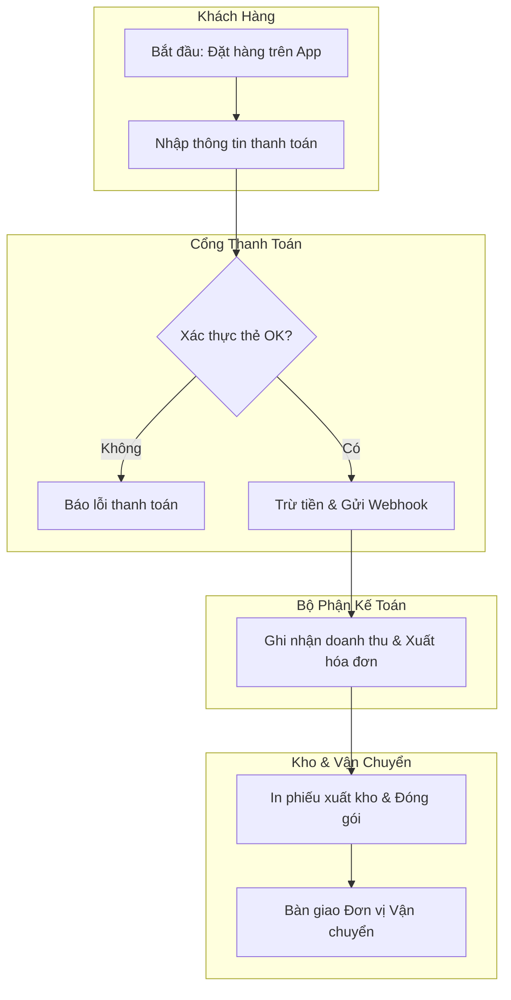
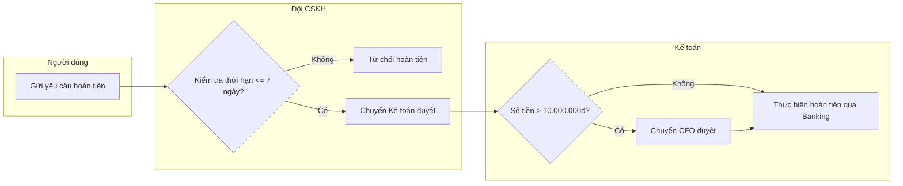

# Business Process & Workflow Specification (`_spec1_business_process`)

> **Version:** 1.0.0  
> **Last Updated:** 2026-07-24  

---

## 1. Mục đích & Phạm vi

Skill này chịu trách nhiệm đặc tả luồng vận hành quy trình nghiệp vụ tổng thể ở mức **Vĩ mô (Macro Level)**. Khác với luồng tính năng đơn lẻ (`_spec2_feature_flow`), skill này tập trung vào sự phối hợp giữa nhiều phòng ban, các nhân sự thực hiện (Actors), các hệ thống phần mềm liên quan và ma trận luật nghiệp vụ phức tạp.

### Đầu ra chính (Outputs):
1. **Biểu đồ Quy trình Nghiệp vụ (BPMN 2.0 / Swimlane Diagram):** Biểu diễn luồng công việc qua các làn (Lanes) đại diện cho các phòng ban, vai trò người dùng và hệ thống.
2. **Biểu đồ SIPOC (Supplier - Input - Process - Output - Customer):** Bóc tách các thành tố đầu vào và đầu ra của quy trình.
3. **Decision Table & Decision Matrix (Ma trận Luật Nghiệp vụ):** Bảng ma trận điều kiện/hành động cho các quy trình nghiệp vụ phức tạp (như tính phí bảo hiểm, chính sách chiết khấu, duyệt tín dụng, phân luồng vận chuyển).
4. **Machine-Readable Business Contract:** Cung cấp thông số quy trình nghiệp vụ để **AI Orchestrator Agent đọc và hiểu bức tranh lớn của toàn hệ thống**.

---

## 2. Quy trình Thực hiện Đặc tả Quy trình Nghiệp vụ (4 Bước)

### Bước 1 — Phân rã Vai trò & Các Làn Nghiệp vụ (Swimlanes & Actors)
Liệt kê tất cả các chủ thể tham gia vào quy trình:
- **Actors (Con người):** Khách hàng, Nhận nhân viên Sale, Kế toán, Quản lý kho, CSKH.
- **Systems (Hệ thống):** Mobile App, CRM Backend, Cổng thanh toán 3rd party, ERP Kho.

### Bước 2 — Vẽ Sơ đồ BPMN 2.0 / Swimlane bằng Mermaid
Sử dụng cú pháp Mermaid `graph TB` hoặc `graph LR` tổ chức theo Subgraphs tương ứng với từng Swimlane:



### Bước 3 — Xây dựng Bảng Ma trận Quyết định (Decision Table / Decision Matrix)
Đối với các quy trình có nhiều luật nghiệp vụ lồng ghép:

| ID Luật | Hạng Khách Hàng | Giá trị Đơn Hàng | Ngày Mua | Áp Dụng Chiết Khấu | Cần duyệt Kế toán |
| :--- | :--- | :--- | :--- | :--- | :--- |
| `RULE_01` | VIP / GOLD | >= 2.000.000đ | Thứ 6 (Flashsale) | **20%** | Không |
| `RULE_02` | VIP / GOLD | < 2.000.000đ | Ngày thường | **10%** | Không |
| `RULE_03` | STANDARD | >= 5.000.000đ | Bất kỳ | **15%** | **Có (Duyệt nợ)** |
| `RULE_04` | NEW | Bất kỳ | Ngày thường | **0%** | Không |

### Bước 4 — Kiểm tra Tính Thông suốt & Rủi ro Vận hành
- Phát hiện các nút thắt cổ chai (Bottlenecks) trong quy trình.
- Xác định điểm rủi ro gián đoạn (SPOF - Single Point of Failure).
- Đưa ra phương án dự phòng (Fallback Operation).

---

## 3. Template Mẫu Output Spec Business Process

```markdown
# Business Process Spec: [Tên Quy Trình Nghiệp Vụ]

> **Target Audience:** CPO, Business Analyst, Lead Dev, Operations Team  

## 1. Biểu đồ Quy trình Nghiệp vụ (BPMN / Swimlane)



## 2. Decision Matrix (Luật Nghiệp vụ Hoàn tiền)

| Điều kiện 1 (Thời gian) | Điều kiện 2 (Số tiền) | Điều kiện 3 (Lý do) | Quyết định Xử lý |
| :--- | :--- | :--- | :--- |
| <= 7 ngày | <= 2.000.000đ | Lỗi sản phẩm | Tự động duyệt hoàn tiền 100% |
| <= 7 ngày | > 2.000.000đ | Lỗi sản phẩm | CSKH xác minh ảnh chụp -> Duyệt |
| > 7 ngày | Bất kỳ | Bất kỳ | Từ chối tự động |
```

---

## 4. Lịch sử Cập nhật (Changelog)

- **v1.0.0 (2026-07-24):** Khởi tạo skill `_spec1_business_process` chuyên biệt cho đặc tả quy trình nghiệp vụ tổng thể (BPMN 2.0, Swimlane Diagrams, SIPOC) và Ma trận Luật Nghiệp vụ (Decision Tables).
