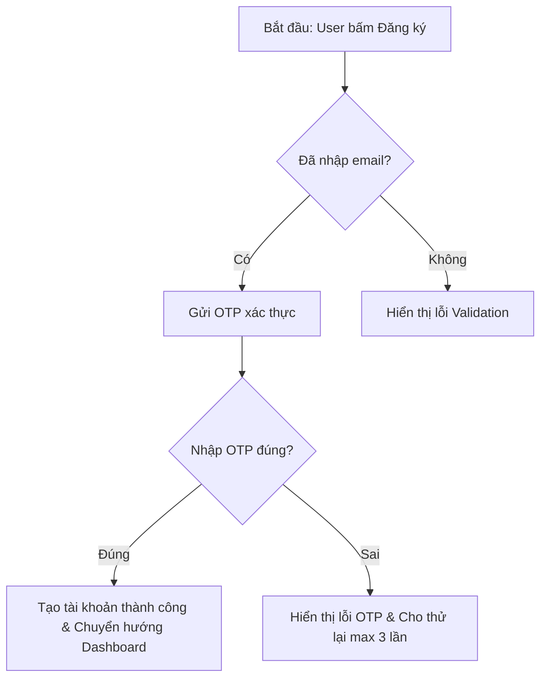
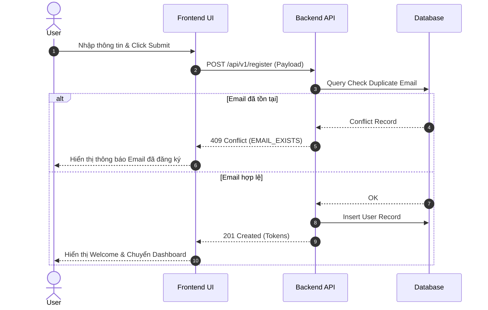

# Feature Flow & Logic Specification (`_spec2_feature_flow`)

> **Version:** 1.0.0  
> **Last Updated:** 2026-07-24  

---

## 1. Mục đích & Phạm vi

Skill này chịu trách nhiệm chuẩn hóa và biểu diễn toàn bộ luồng vận hành (Flows), logic điều kiện (Branching Logic), chuyển đổi trạng thái (State Machine) và chuỗi tương tác hệ thống (Sequence Logic) ở cấp độ **Chi tiết Tính năng (Micro Feature Level)**.

### Đầu ra chính (Outputs):
1. **User Flow Diagram & Step-by-Step Description:** Luồng thao tác của người dùng từ điểm bắt đầu (Trigger) tới điểm kết thúc (Goal/Exit).
2. **System Flow & Sequence Diagram (Mermaid):** Luồng tương tác giữa Frontend UI, Backend API, Database, và dịch vụ bên thứ 3.
3. **State Transition Table & Diagram:** Ma trận chuyển đổi giữa các trạng thái (Idle, Loading, Success, Error, Empty, Offline).
4. **Machine-Readable Logic Rules:** Tập quy tắc rẽ nhánh (if/else), điều kiện tiền đề (Pre-conditions) và hậu điều kiện (Post-conditions) để **Dev Agent đọc và sinh mã chính xác tuyệt đối**.

---

## 2. Quy trình Thực hiện Đặc tả Luồng (4 Bước)

### Bước 1 — Bóc tách Trigger & Happy Path (Luồng Chính)
- Xác định sự kiện kích hoạt (User click, System cron, Webhook).
- Liệt kê các bước thực hiện trên luồng thành công chính (Happy Path).
- Biểu diễn bằng biểu đồ Mermaid Flowchart (`graph TD` hoặc `graph LR`).

### Bước 2 — Mổ xẻ Branching Logic & Exceptional Paths (Rẽ nhánh & Lỗi)
- Liệt kê mọi điều kiện kiểm tra (Validation checks, Permission checks, Limit checks).
- Định nghĩa các luồng phụ (Alternative Paths) và luồng xử lý lỗi (Edge Case / Failure Paths).
- Đảm bảo không có "nút thắt cụt" (Dead ends) trong biểu đồ.

### Bước 3 — Thiết lập State Machine Diagram & Matrix
Mọi màn hình hoặc component phức tạp đều phải được đặc tả bằng State Machine:
- **States:** Idle / Default, Loading / Submitting, Success / Completed, Partial Success, Error (Transient/Fatal), Empty, Unauthorized.
- **Transitions:** State A + Event X (với Condition Y) → State B.

### Bước 4 — Đóng gói Machine-Readable Contract cho AI Execution Agent
Xuất khối logic bằng cú pháp Markdown/Pseudocode rõ ràng:

```markdown
### Logic Execution Contract: `submit_payment_form`
- **Pre-conditions:** `user.is_authenticated == true` AND `cart.items.length > 0`
- **Execution Steps:**
  1. Validate `card_number` format. If invalid → set state `Error("INVALID_CARD")`.
  2. Call API `POST /v1/payments`.
  3. If status == 200 → set state `Success`, trigger event `payment_completed`.
  4. If status == 402 → set state `Error("INSUFFICIENT_FUNDS")`.
- **Post-conditions:** Clear cart state on success.
```

---

## 3. Template Mẫu Output Spec Flow

```markdown
# Feature Flow Spec: [Tên Feature]

> **Ref Master PRD:** [`1_product_requirements/_master_prd.md`](../../1_product_requirements/_master_prd.md)  
> **Target Audience:** Dev, QA, AI Execution Agents  

## 1. User Flow Diagram



## 2. Sequence Diagram (Hệ thống)



## 3. State Transition Matrix

| Trạng thái hiện tại | Sự kiện kích hoạt | Điều kiện | Trạng thái tiếp theo | Hành động hệ thống |
| :--- | :--- | :--- | :--- | :--- |
| `IDLE` | `CLICK_SUBMIT` | Form valid | `SUBMITTING` | Disable button, show spinner |
| `SUBMITTING` | `API_SUCCESS` | HTTP 200/201 | `SUCCESS` | Show toast, redirect after 1.5s |
| `SUBMITTING` | `API_ERROR` | HTTP 4xx/5xx | `ERROR` | Enable button, render error message |
```

---

## 4. Lịch sử Cập nhật (Changelog)

- **v1.0.0 (2026-07-24):** Cập nhật tên skill thành `_spec2_feature_flow` chuẩn hóa đặc tả User Flow, System Flow, State Diagrams và Machine-Readable Logic cho AI Execution Agents.
