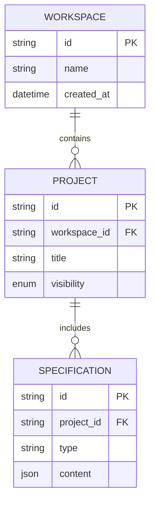

# API Contract & Data Architecture Specification (`_spec4_api_data`)

> **Version:** 1.0.0  
> **Last Updated:** 2026-07-24  

---

## 1. Mục đích & Phạm vi

Skill này chịu trách nhiệm chuẩn hóa giao ước giao tiếp giữa Frontend và Backend (API Contracts), cấu trúc dữ liệu gửi/nằm trong hệ thống (JSON Schemas), mô hình thực thể cơ sở dữ liệu (ERD & Data Models) và ma trận xử lý lỗi hệ thống.

### Đầu ra chính (Outputs):
1. **API Endpoint Specifications:** URL path, HTTP Method (GET, POST, PUT, PATCH, DELETE), Authentication requirements.
2. **JSON Schemas (Request & Response):** Cấu trúc chi tiết payload, kiểu dữ liệu (string, number, boolean, array, object), ràng buộc (enum, min/max, pattern regex), và các trường bắt buộc (required).
3. **HTTP Status & Error Code Matrix:** Ma trận mã lỗi hệ thống và thông điệp chuẩn hóa cho client.
4. **Data Model / ERD Spec (Mermaid):** Mô hình thực thể CSDL, quan hệ giữa các bảng (1-1, 1-N, N-N) và chỉ mục (Indexes).
5. **Machine-Readable Contract cho AI Backend Agent:** Cung cấp thông số kỹ thuật chuẩn mực để **AI Dev Agent có thể sinh code API Controller, DTO, Database Migration và ORM Models** mà không bị lệch schema.

---

## 2. Quy trình Thực hiện Đặc tả API & Data (4 Bước)

### Bước 1 — Thiết kế API Contract Endpoint & Headers
- Định nghĩa chuẩn RESTful hoặc GraphQL Operation:
  - `POST /api/v1/auth/login`
  - Headers: `Content-Type: application/json`, `Authorization: Bearer <token>`

### Bước 2 — Chuẩn hóa JSON Payload Schemas
- Khai báo mẫu JSON ví dụ (Example Payload) kèm JSON Schema đặc tả kiểu dữ liệu:
```json
{
  "email": "user@example.com",
  "role": "MEMBER"
}
```

### Bước 3 — Thiết lập Ma trận Xử lý Lỗi (Error Matrix)
Tất cả các lỗi API phải theo chuẩn thống nhất:
```json
{
  "success": false,
  "error": {
    "code": "INVALID_CREDENTIALS",
    "message": "Email hoặc mật khẩu không chính xác.",
    "details": []
  }
}
```

### Bước 4 — Xây dựng ERD Diagram & Model Spec
Vẽ sơ đồ ERD bằng Mermaid `erDiagram` và định nghĩa trường dữ liệu trong bảng.

---

## 3. Template Mẫu Output Spec API & Data

```markdown
# API & Data Spec: [Tên Feature / Subsystem]

> **Target Audience:** Backend Dev, Frontend Dev, Database Admin, AI Backend Agent  

## 1. API Contract: `POST /api/v1/projects`

- **Description:** Tạo mới dự án trong Workspace
- **Auth Required:** Yes (`Bearer Token`)

### Request Headers
| Header | Value | Required | Description |
| :--- | :--- | :--- | :--- |
| `Content-Type` | `application/json` | Yes | MIME Type |
| `Authorization` | `Bearer <token>` | Yes | Access Token |

### Request Body (JSON Schema)
```json
{
  "title": "Hệ thống AI Spec", // Required, string, 3..100 chars
  "description": "Mô tả ngắn",  // Optional, string, max 500 chars
  "visibility": "PRIVATE"        // Required, enum: ["PUBLIC", "PRIVATE", "INTERNAL"]
}
```

### Response Success (HTTP 201 Created)
```json
{
  "success": true,
  "data": {
    "id": "proj_123456789",
    "title": "Hệ thống AI Spec",
    "visibility": "PRIVATE",
    "created_at": "2026-07-24T08:00:00Z"
  }
}
```

### Error Code Matrix
| HTTP Status | Error Code String | Cause / User Message |
| :--- | :--- | :--- |
| `400 Bad Request` | `VALIDATION_FAILED` | Dữ liệu đầu vào không hợp lệ |
| `401 Unauthorized` | `TOKEN_EXPIRED` | Phiên đăng nhập hết hạn |
| `409 Conflict` | `PROJECT_TITLE_DUPLICATE` | Tên dự án đã tồn tại trong workspace |

---

## 2. Data Model & ERD


```

---

## 4. Lịch sử Cập nhật (Changelog)

- **v1.0.0 (2026-07-24):** Cập nhật tên skill thành `_spec4_api_data` chuẩn hóa đặc tả API Endpoints, JSON Schemas, ERD Diagrams và Machine-Readable Contracts cho AI Backend Agents.
